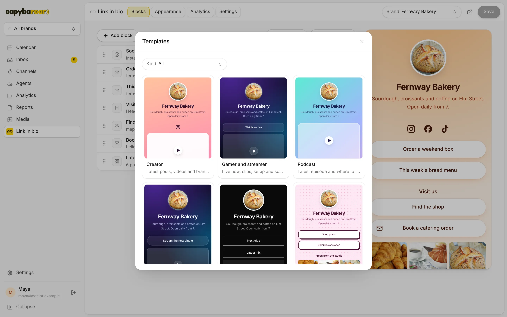
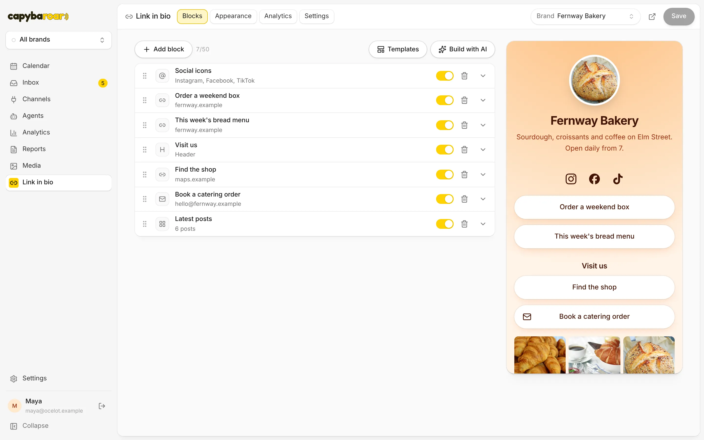
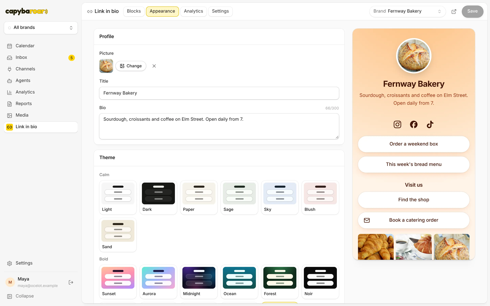
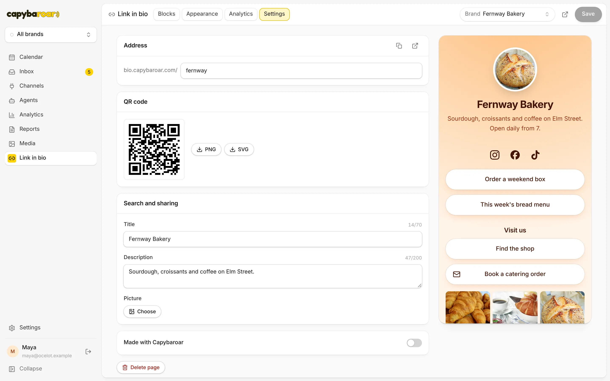
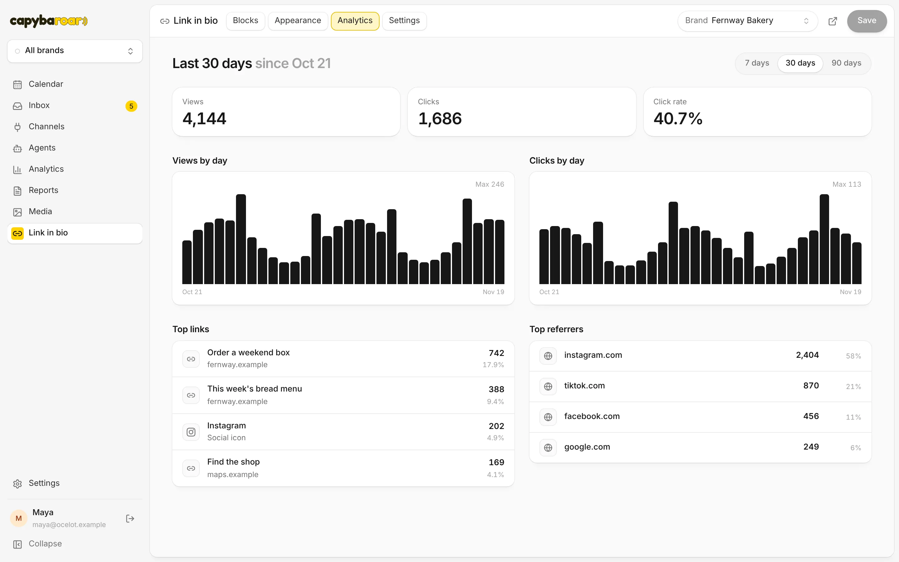

import { Aside, Badge, CardGrid, LinkCard, LinkButton, Steps } from '@astrojs/starlight/components';

Put your links and latest posts on one page at your own address, with every visit and click counted. Put its link in your profiles. Each brand has its own page.

<LinkButton href="https://app.capybaroar.com/bio" variant="secondary" icon="external">Open in Capybaroar</LinkButton>

## Make your page

<Steps>

1. **Open Link in bio.** Click **Link in bio** in the sidebar. With more than one brand, pick the brand first.

1. **Start from a template, or from AI.** Press **Templates** and pick a kind of page, then **Use template**. Or press **Build with AI**, say what the page is for and add your website. Capybaroar drafts the page for you to edit.

   

1. **Add your blocks.** Under **Blocks**, press **Add block**. Drag blocks to change their order.

   

1. **Fill in anything marked Add your link.** Template blocks start with sample links. Each one shows **Add your link** or **Add your email** until you change it.

1. **Press Save.** Your page is live at its address.

</Steps>

Build with AI uses 40 [AI credits](/ai/ai-credits/) and needs a plan with AI. Using a template replaces the page's blocks and look.

## Blocks

| Block | What it shows |
| - | - |
| **Link** | A button to any page. You can add a picture, and **Show only between** a start and end time. |
| **Header** | A short title to split the page into parts |
| **Text** | A few lines of your own words |
| **Social icons** | Icons that link to your profiles |
| **Latest posts** | A grid of your newest published posts with pictures. Pick 3, 6, 9 or 12, and set a link for each post if you like. |
| **Video** | A YouTube or TikTok video |
| **Email** | A button that opens an email to you, with a subject you choose |

A page holds up to 50 blocks. Hide a block to keep it without showing it. A scheduled link shows **Scheduled** before its start, **Live** while it shows and **Ended** after.

## Appearance

Under **Appearance**, fill in the **Profile** at the top of the page, with your picture and a short bio. Pick a **Theme** from 17, grouped as **Calm** and **Bold**. Then set the **Buttons** shape (**Pill**, **Rounded** or **Square**), their **Fill** (**Solid**, **Outline**, **Pop** or **Glass**), the **Text size** and the **Font**. The **Preview** shows each change as you make it.

## Settings

- **Address:** the end of your page's link. Press **Copy link** to share it, or **Open page** to see it live.
- **QR code:** a code people can scan to open your page, for print and packaging.
- **Search and sharing:** the title, description and picture that show in search results and when someone shares your link.
- **Made with Capybaroar:** paid plans can turn this badge off. On Free it always shows.
- **Delete:** removes the page. Its address stops working.

## See visits and clicks

The **Analytics** tab shows **Views**, **Clicks** and the **Click rate** for 7, 30 or 90 days. **Top links** shows which links people tap, and **Top referrers** shows where your visitors came from.

<Aside type="tip">
Every link on the page is a short link that counts its clicks, so the numbers stay right wherever people find your page.
</Aside>

## Themes and fonts

| Group | Themes |
| - | - |
| **Calm** | Light, Dark, Paper, Sage, Sky, Blush, Sand |
| **Bold** | Sunset, Aurora, Midnight, Ocean, Forest, Noir, Capy, Lime, Candy, Lavender, Peach |

| Font | Looks like |
| - | - |
| **Clean** | Inter |
| **Editorial** | Fraunces, a serif |
| **Geometric** | Space Grotesk |
| **Mono** | JetBrains Mono |
| **Friendly** | Nunito, rounded |
| **Display** | Bricolage Grotesque |

**Social icons** can link to Instagram, TikTok, YouTube, X, Facebook, LinkedIn, Threads, Pinterest, Bluesky, Mastodon, Telegram, Reddit, WhatsApp, Spotify, Twitch, Snapchat and GitHub.

## Your page's address

Each page lives at its own address on Capybaroar, like `capybaroar.com/fernway`. When you make a page, Capybaroar picks a free address from the brand's name. Change it under **Settings**, **Address**:

- 3 to 40 characters.
- Lowercase letters, numbers and dashes, starting and ending with a letter or number.
- One dash at a time.
- Some words, and anything starting with `capybaroar`, are reserved.

Changing the address makes the old one stop working, so update your profiles too.

## Limits

| What | Limit |
| - | - |
| Pages | One for each brand |
| Blocks | 50 |
| Title | 80 characters |
| Bio | 300 characters |
| Search title | 70 characters |
| Search description | 200 characters |

## Who can use it

Owners, admins and editors, for their brands. Clients don't see **Link in bio**. Visitors need no account to see a page.

## Related

<CardGrid>
  <LinkCard title="Analytics" href="/results/analytics/" />
  <LinkCard title="Errors with link in bio" href="/errors/results/#link-in-bio" />
  <LinkCard title="AI credits" href="/ai/ai-credits/" />
</CardGrid>
