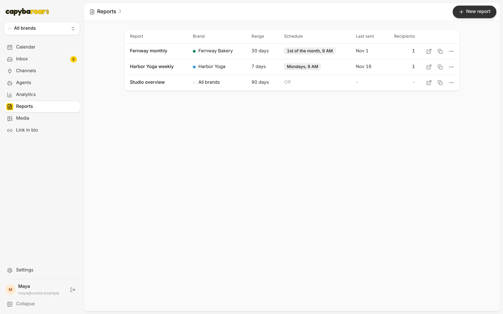
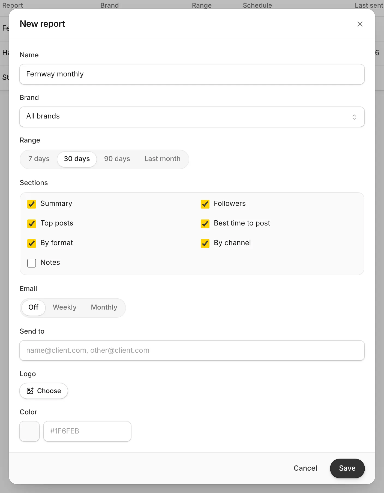

import { Aside, Badge, CardGrid, LinkCard, LinkButton, Steps } from '@astrojs/starlight/components';

A report is a brand's results on one page you can share: a link that's always up to date, a PDF, and an email every week or month. Reports come with Pro and Agency, and the trial.

<LinkButton href="https://app.capybaroar.com/reports" variant="secondary" icon="external">Open in Capybaroar</LinkButton>

On Free and Creator, **Reports** says **Reports for your clients** with **Upgrade** for owners and admins.

## Make a report

<Steps>

1. **Open Reports** in the sidebar. With none yet, it says **Make your first report**. Press **New report**.

1. **Fill in the report** (each field is below), then press **Save**.

   

1. **Share it.** Press **Copy link** on its row and send it. Press **Open** to see it yourself.

</Steps>

## The fields

| Field | What it's for |
| - | - |
| **Name** | Like "Monthly results". Up to 80 characters. |
| **Brand** | Whose results it shows. Shown when you work in **All brands**. |
| **Range** | **7 days**, **30 days** (to start), **90 days** or **Last month** |
| **Sections** | What the report shows, below |
| **Notes** | Your own words at the end, up to 5,000 characters. Shown when **Notes** is ticked. |
| **Email** | **Off** (to start), **Weekly** or **Monthly** |
| **Send to** | Email addresses, split by commas, up to 20 |
| **Logo** and **Color** <Badge text="Agency" /> | Your agency's logo from Media and a color like `#1F6FEB`, in place of Capybaroar's |

### Sections

| Section | What it shows |
| - | - |
| **Summary** | Posts out, reach, engagements and engagement rate, against the period before |
| **Followers** | Followers gained over the period |
| **Top posts** | The posts with the most engagements |
| **Best time to post** | The week-by-hour grid, in the workspace's time zone |
| **By format** | Video, picture and text posts side by side |
| **By channel** | Each channel's followers, posts, reach and engagements |
| **Notes** | Your notes |

All but **Notes** start ticked.

## The report page

The link opens the report with the brand's name, the period and the sections you picked. It reads today's numbers each time it opens, so the link is never out of date. The bottom says **Prepared by** your workspace. On plans without white-label, it also says **Made with Capybaroar**.

**Download PDF** at the top prints it to a PDF that fits A4 pages.

Anyone with the link can open it, without an account. If the report is deleted, the link shows **This report link was turned off**.

## Emails

With **Email** set to **Weekly**, the report is emailed on **Mondays, 9 AM**. With **Monthly**, on the **1st of the month, 9 AM**. Both use the workspace's time zone. The email has the link to the report.

**Send now** in the report's menu emails it right away. It's limited to 5 times an hour for one report, and 50 report emails a day for the workspace.

## The Reports table

| Column | What it shows |
| - | - |
| **Report** | Its name |
| **Brand** | Its brand |
| **Range** | Its range |
| **Schedule** | **Mondays, 9 AM**, **1st of the month, 9 AM**, or nothing |
| **Last sent** | When an email last went out |
| **Recipients** | How many addresses it goes to |

Each row has **Open**, **Copy link**, and a menu with **Send now**, **Edit** and **Delete**. Deleting asks **Delete `<name>`?** and says **Its link stops working.**

## Your logo on reports <Badge text="Agency" />

On Agency, pick a **Logo** from your media library and a **Color**. The report page and its emails show your logo and color, and leave out Capybaroar's name and **Made with Capybaroar**. Clients see your agency.

<Aside type="tip">
Make one report per client brand with **Range** set to **Last month** and **Email** set to **Monthly**. On the 1st, every client gets last month's results without you lifting a finger.
</Aside>

## Who can make reports

Owners, admins and editors, for their brands.

## Related

<CardGrid>
  <LinkCard title="Analytics" href="/results/analytics/" />
  <LinkCard title="Send a monthly client report (recipe)" href="/recipes/monthly-client-report/" />
  <LinkCard title="Errors with reports" href="/errors/results/#reports" />
</CardGrid>
