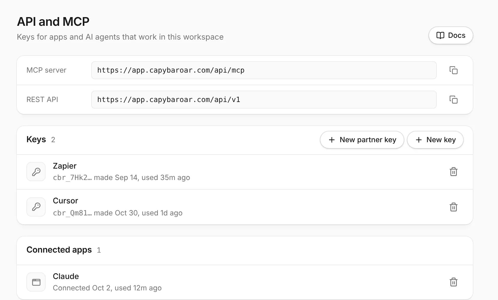
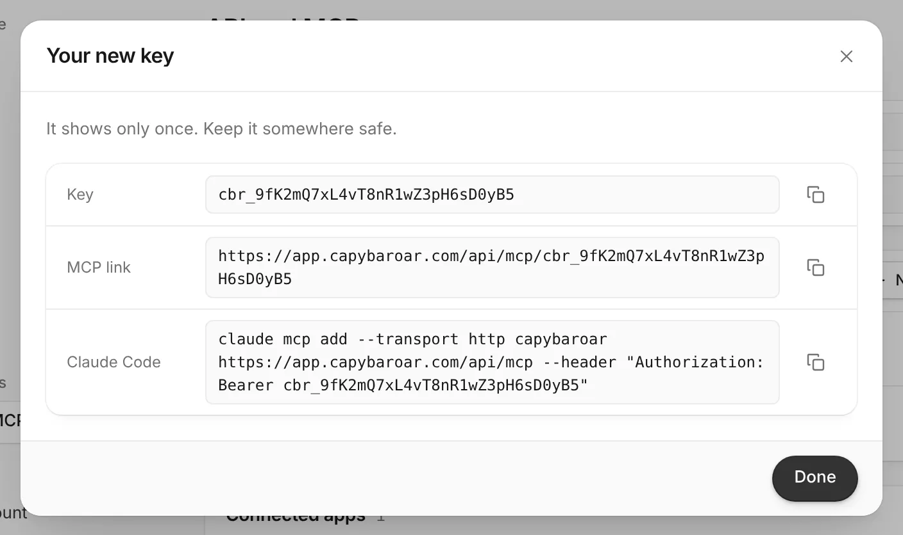
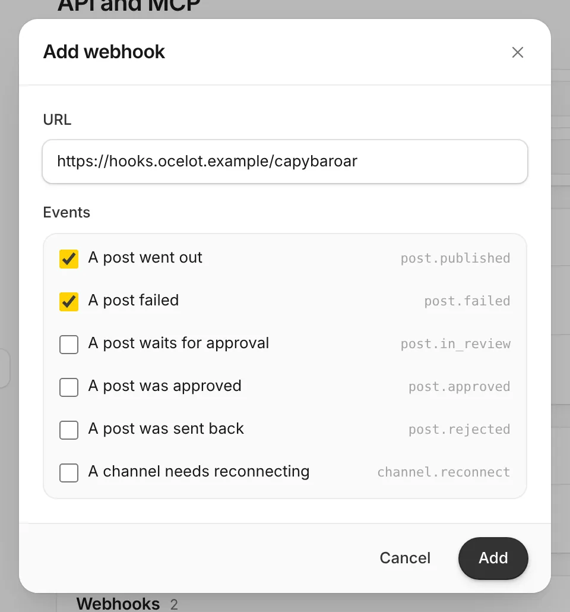

import { Aside, CardGrid, LinkCard, LinkButton, Steps } from '@astrojs/starlight/components';

**API and MCP** is where owners and admins let other apps and AI tools work in the workspace. The line under the title says **Keys for apps and AI agents that work in this workspace**. Everything here is on every plan, Free too.

<LinkButton href="https://app.capybaroar.com/settings?tab=api" variant="secondary" icon="external">Open in Capybaroar</LinkButton>

## Addresses

| Address | Value | Copy it for |
| - | - | - |
| **MCP server** | `https://app.capybaroar.com/api/mcp` | Claude, Claude Code, ChatGPT, Cursor and other AI apps |
| **REST API** | `https://app.capybaroar.com/api/v1` | Your own code, Zapier-style tools, scripts |

Each has a copy button.

## Keys

The **Keys** card lists each key with its name, its first characters, when it was made and when it was last used. The count beside **Keys** shows how many there are, up to 25.

### Make a key

<Steps>

1. **Press New key.**

1. **Name it** in **New API key**, after the app that will use it, like "Claude, Cursor, our website". Press **Make key**.

1. **Copy what you need** from **Your new key**:
   - **Key**: the key itself, starting with `cbr_`.
   - **MCP link**: the MCP server address with the key in it, for apps that only take a link.
   - **Claude Code**: a ready command that adds Capybaroar to Claude Code with this key.

   

1. **Press Done.** The key never shows again.

</Steps>

A key acts as the person who made it, with their role and brands, checked on every request. See [Authentication](/api-reference/authentication/).

### Delete a key

Press **Delete key** on its row. The box asks **Delete `<name>`?** and says **Apps using this key stop working.** Press **Delete**. It stops at once.

## Connected apps

Apps that connect with a Capybaroar sign-in, like Claude's connector or ChatGPT, show under **Connected apps** with the count. They have no key to copy: the person signs in, picks the workspace and presses **Allow**.

To cut one off, press **Remove app**. The box asks **Remove `<app>`?** and says **It stops working right away. You can connect it again later.**

## Webhooks

The **Webhooks** card lists each webhook:

| Part | What it shows |
| - | - |
| The URL | Where events go |
| Events | The events it gets |
| Last delivery | `Answered 200, 5 minutes ago`, the last error, or **Nothing sent yet** |
| The switch | **Turn off** or **Turn on**. Turning one on again starts its failure count over. |
| **Send a test** | Sends a `ping` event now. You see **Test sent**. |
| **Delete webhook** | Asks **Delete this webhook?** with its URL |

### Add a webhook

Press **Add webhook**. Type an `https://` **URL** and tick the **Events**. **A post went out** and **A post failed** start ticked. Press **Add webhook**. **Webhook added** shows the signing **Secret** once. Copy it and press **Done**.

| Event in Settings | Event name |
| - | - |
| A post went out | `post.published` |
| A post failed | `post.failed` |
| A post waits for approval | `post.in_review` |
| A post was approved | `post.approved` |
| A post was sent back | `post.rejected` |
| A channel needs reconnecting | `channel.reconnect` |

A workspace can have up to 10 webhooks. See [Webhook events](/api-reference/webhook-events/) for the payloads and how to check signatures.

<Aside type="caution">
A key or MCP link can post as you. Keep it out of shared code, chats and screenshots. If one leaks, delete it here and make a new one.
</Aside>

## Who can use this tab

Owners and admins. Editors don't see it, and clients can't use the API at all.

## Related

<CardGrid>
  <LinkCard title="API reference" href="/api-reference/" />
  <LinkCard title="Use Capybaroar from Claude, ChatGPT or Cursor" href="/ai/mcp/" />
  <LinkCard title="Webhooks guide" href="/developers/webhooks/" />
</CardGrid>
