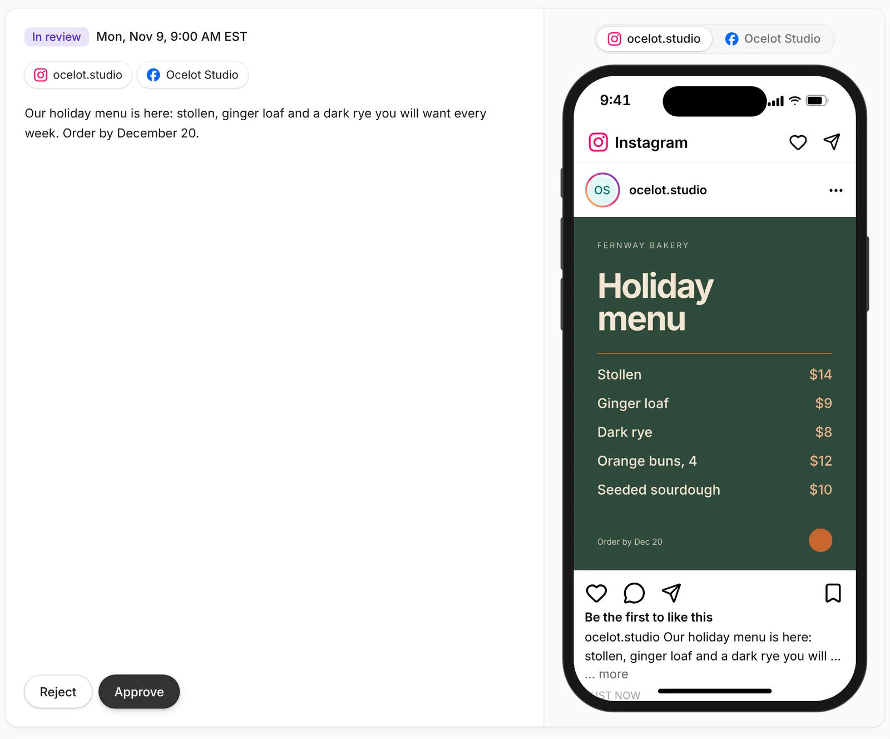
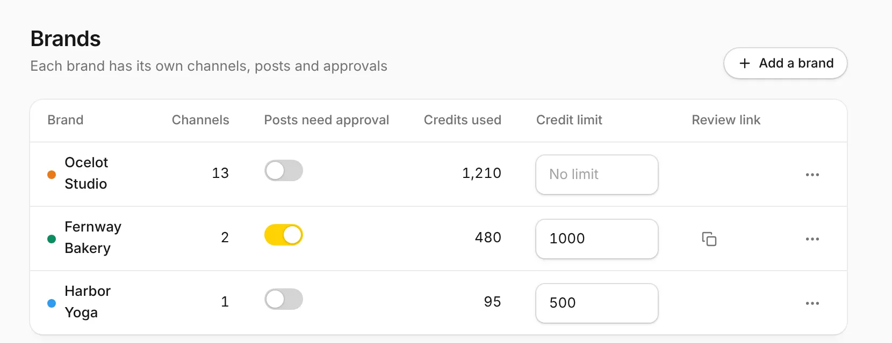
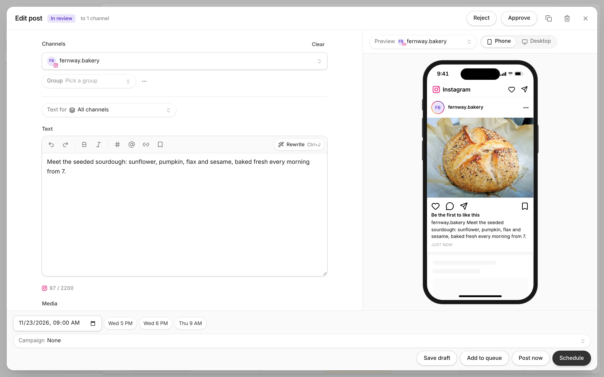
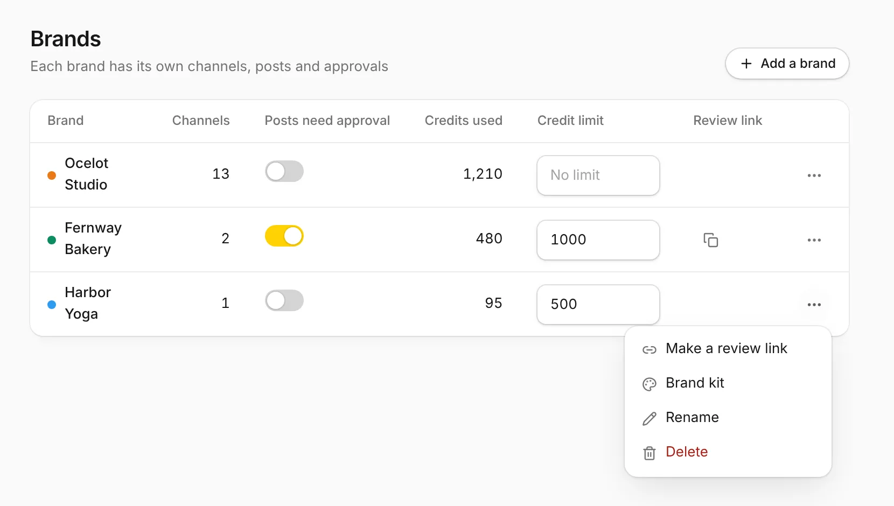
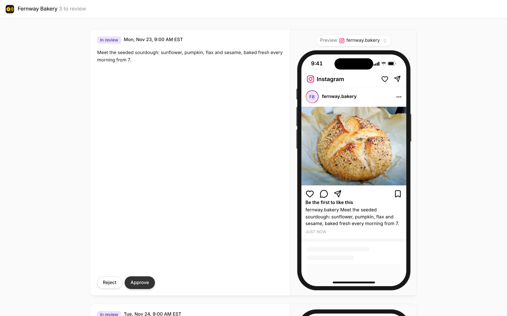

import { Aside, CardGrid, LinkCard, LinkButton, Steps } from '@astrojs/starlight/components';

With approvals on, an editor's posts for a brand wait in review until someone says yes. Clients can approve or reject from a review link, with no account needed. Approvals come with Pro and Agency.

<LinkButton href="https://app.capybaroar.com/settings?tab=brands" variant="secondary" icon="external">Open in Capybaroar</LinkButton>

<video class="walkthrough" src="/videos/approve-post.mp4" autoplay muted loop playsinline preload="metadata" width="1280" height="800" aria-label="Checking a post in review and rejecting it with a comment" title="Checking a post in review and rejecting it with a comment"></video>

## Turn on approvals for a brand

<Steps>

1. **Open Brands.** Click **Settings**, then **Brands**.

1. **Switch on Posts need approval** for the brand.

   

</Steps>

From then on, when an editor schedules, queues or posts a post for that brand, it goes to **In review** instead. Posts by owners and admins skip review, since they can approve.

## Approve or reject in the app

Owners, admins and the brand's clients get an email when a post needs approval. Open the post from the calendar, check the preview and press **Approve** or **Reject**.

- **Approve** schedules the post for its time. If that time has passed, it goes out right away.
- **Reject** asks **What should change?** Your note goes back to the author with the post, which returns to **Draft**.

The author gets an email either way. The post shows each decision under **Approval**, with who made it and when.

## Share a review link with a client

A review link shows a brand's posts in review, as they will look on each network, with **Approve** and **Reject**. Clients don't need an account to use it.

<Steps>

1. **Open Brands.** Click **Settings**, then **Brands**.

1. **Make the link.** Open the brand's menu and press **Make a review link**.

   

1. **Copy it.** Press **Copy review link** in the **Review link** column and send it to your client.

</Steps>

Decisions made from the link show as **Review link** on the post. To stop a link working, press **Turn off review link** in the brand's menu.

<Aside type="caution">
Anyone with the review link can approve or reject that brand's posts. Share it only with the people who sign off.
</Aside>

## Invite clients instead

For clients who want to see the calendar, invite them with the **Client** role in **Settings**, **Members**, and pick their brands. They see the calendar for those brands and approve or reject posts there. They also get the approval emails. Clients never take a paid seat. See [Team, roles and brands](/workspace/team-and-roles/).

## Step by step

| Step | Who | What happens |
| - | - | - |
| An editor schedules, queues or posts | Editor | The post goes to **In review** at its time. Owners, admins and the brand's clients get an email. Webhooks get `post.in_review`. |
| Someone opens it | Owner, admin or client | The calendar shows it in violet with **In review**. The editor shows **Approve** and **Reject**. |
| **Approve** | Owner, admin, client or review link | It's scheduled for its time, or goes out at once if the time has passed. The author gets an email. Webhooks get `post.approved`. |
| **Reject** | Owner, admin, client or review link | **Reject this post** asks **What should change?**. The post goes back to **Draft** with the comment. The author gets an email. Webhooks get `post.rejected`. |
| The editor fixes it | Editor | They change the draft and schedule it again. It goes back to review. |

While a post is in review, it can still be changed. Moving it on the calendar keeps it in review.

## The review page

The review link opens a page with the brand's name and every post waiting for approval. Each post shows **In review**, its time, and a **Preview** menu to see it as it will look on each of its channels. **Approve** and **Reject** sit under each one. When nothing is waiting, the page says **Nothing to review**.

If the link was turned off, the page says **This review link was turned off**.

## Who can approve

| Role | Approve and reject | Skip review |
| - | - | - |
| Owner | Yes | Yes |
| Admin | Yes | Yes |
| Editor | No | No |
| Client | Yes, for their brands | They can't write posts |
| Anyone with the review link | Yes, for that brand | |

Approvals need Pro or Agency. On Free and Creator, the **Posts need approval** switch answers `Approvals come with Pro and Agency. Upgrade to use them.`

## Webhooks for approvals

The `post.in_review`, `post.approved` and `post.rejected` events tell your own tools when a post moves through review. See [Webhooks](/developers/webhooks/).

## Related

<CardGrid>
  <LinkCard title="Team, roles and brands" href="/workspace/team-and-roles/" />
  <LinkCard title="The calendar" href="/publishing/calendar-and-queue/" />
  <LinkCard title="Brands" href="/workspace/brands/" />
</CardGrid>
