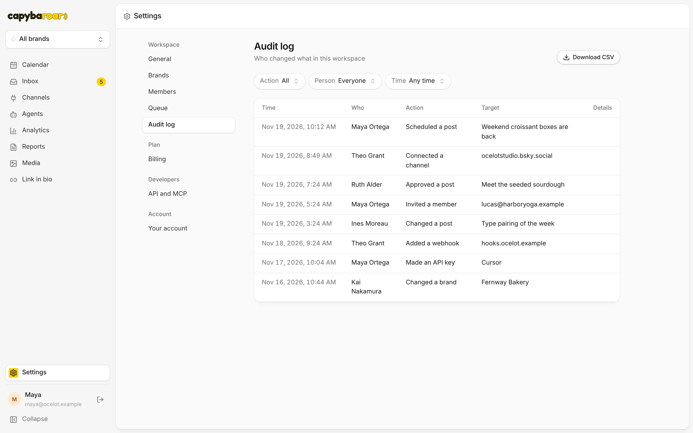

import { Aside, CardGrid, LinkCard, LinkButton } from '@astrojs/starlight/components';

The audit log lists who changed what in the workspace, and when. Use it to check who removed a channel, which key made a post, or who signed in from a new device.

<LinkButton href="https://app.capybaroar.com/settings?tab=audit" variant="secondary" icon="external">Open in Capybaroar</LinkButton>

## Who can see it

Owners and admins, in **Settings**, **Audit log**. Others get `Only owners and admins can see the audit log`.

## Filters

| Filter | Choices |
| - | - |
| **Action** | **All**, **Sign-in**, **Members**, **Brands**, **Channels**, **Posts**, **API and apps**, **Billing**, **Workspace** |
| **Person** | **Everyone**, or one member by name and email |
| **Time** | **Any time**, **Last 7 days**, **Last 30 days**, **Last 90 days** |

With nothing to show, the list says **No events yet**, or **No matches** when a filter hides everything.

## The columns

| Column | What it shows |
| - | - |
| **Time** | When it happened, in the workspace's time zone |
| **Who** | The person. A request through an API key is marked **API**, and one from a signed-in app, like Claude, is marked **App**. Decisions from a review link show as **Review link**, and Capybaroar's own work as **Capybaroar**. |
| **Action** | What happened, like **Connected a channel** |
| **Target** | What it happened to: a post's first words, a channel, a member's email, a webhook's host |
| **Details** | More about it, like the role someone got |

The newest 50 show first. Press **Load more** for the next 50.

## What's recorded

| Area | Events |
| - | - |
| **Sign-in** | Signed in, Sign-in failed, Reset their password, Signed in on a new device, Signed out, Signed out other devices, Signed out everywhere from an alert email, Signed in with a leaked password, Turned on 2FA, Turned off 2FA, Changed the 2FA rule |
| **Members** | Invited someone, Withdrew an invite, Joined the workspace, Changed a role, Changed someone's brands, Removed someone, Left the workspace |
| **Brands** | Added a brand, Renamed a brand, Deleted a brand, Changed approvals, Changed a review link |
| **Channels** | Connected a channel, Removed a channel, Moved a channel to a brand |
| **Posts** | Deleted a post, Deleted a post on the networks, Edited a published post, Deleted a file |
| **API and apps** | Made an API key, Deleted an API key, Connected an app, Disconnected an app, Added a webhook, Changed a webhook, Deleted a webhook |
| **Billing** | Changed the plan, Changed a credit limit |
| **Workspace** | Renamed the workspace, Changed workspace settings, Asked to delete the workspace, Exported data, Deleted their account |

Webhooks are shown by their host only, since a webhook's full address can hold a secret.

## Download as CSV

Press **Download CSV** to save the events that match your filters, up to 10,000 rows. Open it in any spreadsheet.

## How long events are kept

Events are kept for 365 days, then deleted. They stay after someone leaves the workspace or deletes their account.

<Aside type="note">
The audit log can't be changed or cleared, by anyone. It's a record of what happened.
</Aside>

## Related

<CardGrid>
  <LinkCard title="Your account and security" href="/workspace/your-account/" />
  <LinkCard title="Roles and permissions" href="/reference/roles-and-permissions/" />
</CardGrid>
