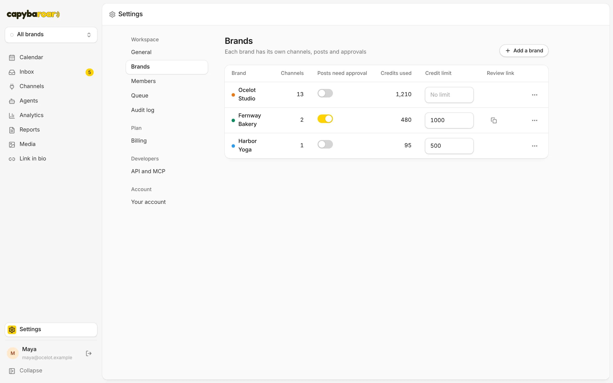
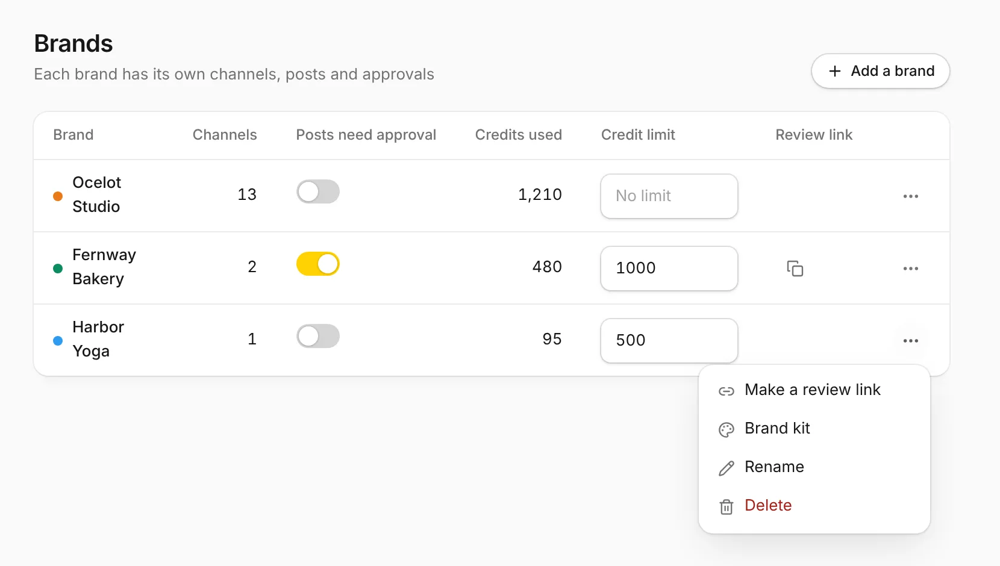
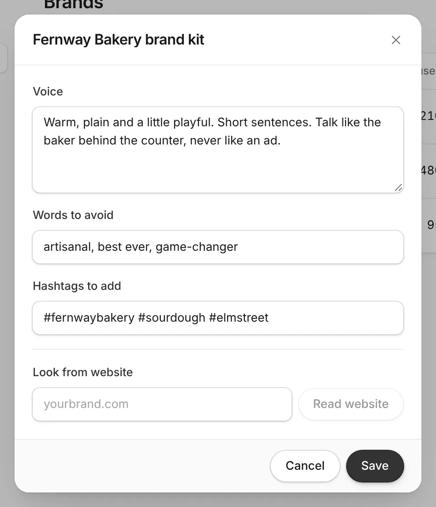

import { Aside, Badge, CardGrid, LinkCard, LinkButton, Steps } from '@astrojs/starlight/components';

A brand is one client, product or company. Each brand has its own channels, calendar, Inbox, results, files, feeds, review link and link in bio page. Agencies use one brand per client, so a client's people only ever see their own work.

<LinkButton href="https://app.capybaroar.com/settings?tab=brands" variant="secondary" icon="external">Open in Capybaroar</LinkButton>

## Who can manage brands

Owners and admins, in **Settings**, **Brands**. Editors and clients work only in the brands they were given, and don't see this tab.

| Plan | Brands |
| - | - |
| Free, Creator | 1 |
| Pro | 5 |
| Agency | No limit |

## The Brands table

The line under the title says **Each brand has its own channels, posts and approvals**.

| Column | What it shows |
| - | - |
| **Brand** | The brand's color dot and name |
| **Channels** | How many channels it has |
| **Posts need approval** | A switch. On means editors' posts for this brand wait in review. Pro and Agency. |
| **Credits used** | AI credits the brand used this month. Agency. |
| **Credit limit** | The most credits the brand may use a month. Agency. |
| **Review link** | **Copy review link**, once the brand has one |
| (menu) | **More for `<brand>`**: review link, brand kit, rename and delete |

## Add a brand

Press **Add a brand**, type its name in **New brand** and press **Add**. Names are up to 60 characters. Over your plan's limit, you see `Your plan allows <n> brands. Upgrade to add more.`

Then give it channels:

- Pick the brand in the sidebar's brand menu, then connect channels. New channels join the brand you're in.
- Or move channels on **Channels**, in each channel's **Brand** column.

## The brand menu in the sidebar

The menu at the top of the sidebar shows the brand you're working in. Pick another brand to switch every screen to it. Owners and admins with more than one brand can pick **All brands** to see everything at once. With many brands, the menu has **Search brands**. **Manage brands** opens this tab.

If you belong to more than one workspace, the same menu switches workspaces.

## Approvals

Switch on **Posts need approval** for a brand. From then on, an editor's post for it goes to **In review** when they schedule, queue or post it. Owners' and admins' posts skip review. See [Approvals](/workspace/approvals/).

## Review links

A review link is a page where someone approves or rejects a brand's posts in review, with no account.

- **Make a review link** in the brand's menu makes one. Then **Copy review link** shows in the table.
- **Turn off review link** stops it working. The box asks **Turn off the review link for `<brand>`?** and says **The link stops working.**
- Making a new link replaces the old one.

## The brand kit

Press **Brand kit** in the brand's menu. The kit tells the AI how to write for this brand: the agent, **Rewrite**, AI threads and formats, captions and suggested replies all follow it.

| Field | What to put in it | Limit |
| - | - | - |
| **Voice** | How the brand sounds, like "Warm and plain. Short sentences. We say we, never I." | 1,500 characters |
| **Words to avoid** | Words the AI shouldn't use, split by commas. The post editor also warns you, with `Words to avoid: ...`, when your own text has one. | 40 characters each |
| **Hashtags to add** | Hashtags the brand uses, like `#crumbandco #sourdough` | 40 characters each |
| **Look from website** | The brand's website, for CapyInfographic and CapyMotion | |

Press **Save** to keep it, or **Cancel**.

### The brand's look

Type the website in **Look from website** and press **Read website**. Capybaroar reads the site's colors, fonts and logo, and CapyInfographic and CapyMotion use them so graphics look like the brand. Press **Read again** after the site changes, or **Clear** to forget it. The agent can also read it the first time it makes a graphic for a brand.

## Credit limits

On Agency, set a **Credit limit** for each brand, in credits a month. Leave it empty for no limit. When a brand reaches its limit, AI for that brand stops with `This brand has used its credits for this month` until the next refill, or until you raise it. Limits must be whole numbers. See [AI credits](/ai/ai-credits/).

## Rename or delete a brand

- **Rename** opens **Rename brand** with its name. Change it and confirm.
- **Delete** asks **Delete `<brand>`?**. A brand with channels can't be deleted: move or remove its channels first. A workspace always keeps at least one brand, so the last one can't be deleted.

<Aside type="caution">
Deleting a brand removes its review link, its link in bio page and its brand kit. Its posts and files stay in the workspace with no brand, so only owners and admins see them under **All brands**.
</Aside>

## What a brand keeps apart

| Thing | Belongs to |
| - | - |
| Channels | One brand each |
| Posts | The brand of their channels. A post can't mix brands. |
| Files in Media | The brand they were uploaded for, or the whole workspace |
| Channel groups, feeds, reports, link in bio | One brand each |
| Campaigns | One brand, or the whole workspace |
| Members | Editors and clients see the brands picked for them |

## Related

<CardGrid>
  <LinkCard title="Team and roles" href="/workspace/team-and-roles/" />
  <LinkCard title="Approvals" href="/workspace/approvals/" />
  <LinkCard title="Run approvals for a client (recipe)" href="/recipes/client-approval-flow/" />
</CardGrid>
