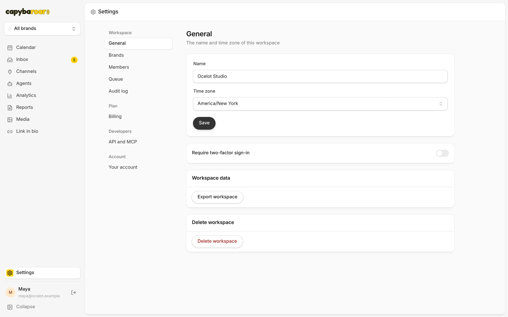

import { Aside, CardGrid, LinkCard, LinkButton, Steps } from '@astrojs/starlight/components';

**General** holds the settings for the whole workspace. It's the first tab owners and admins see in **Settings**.

<LinkButton href="https://app.capybaroar.com/settings?tab=general" variant="secondary" icon="external">Open in Capybaroar</LinkButton>

## The Settings screen

Settings has a list of tabs on the left, in groups. On a phone, the tabs are one row that scrolls sideways.

| Group | Tabs | Who sees them |
| - | - | - |
| **Workspace** | **General**, **Brands**, **Members**, **Queue**, **Audit log** | Owners and admins |
| **Plan** | **Billing** | Owners and admins |
| **Developers** | **API and MCP** | Owners and admins |
| **Account** | **Your account** | Everyone |

Editors and clients see only **Your account**. Each tab has its own address, like `/settings?tab=brands`, so you can share a link to it.

## Name and time zone

The line under **General** says **The name and time zone of this workspace**.

| Field | What it's for |
| - | - |
| **Name** | The workspace's name, shown in the sidebar, the workspace menu, invites and emails |
| **Time zone** | The zone for queue times, best times, analytics days and scheduled report emails |

Press **Save**. You see **Saved** beside the button, or the reason it didn't save, like `Enter a name`.

The time zone list has every zone your browser knows, like `America/New York` or `Europe/Berlin`. The post editor and calendar show times in your own browser's zone. The workspace's zone is used where everyone needs the same clock.

## Require two-factor sign-in

The **Require two-factor sign-in** switch makes everyone in the workspace use two-factor sign-in.

<Steps>

1. **Turn on 2FA for yourself first,** in **Your account**. Until you do, the switch answers `Turn on 2FA for your account first`.

1. **Switch it on.** Only the owner can. For admins it's shown but greyed out.

</Steps>

From then on, a member without two-factor is asked to set it up the next time they open the workspace. They can't turn it off while the rule is on: **Turn off 2FA** answers `<workspace> requires 2FA`. See [Your account and security](/workspace/your-account/).

## Export workspace

Owners see **Workspace data** with **Export workspace**. It makes a ZIP of everything in the workspace: brands, members and invites, channels (with no sign-in tokens), posts and their results, comments, campaigns, groups, feeds, reports, the Inbox, link in bio, credits, webhooks, the audit log, and every file in Media.

<Steps>

1. **Press Export workspace.** The status shows **Preparing**.

1. **Wait for the email.** When the ZIP is ready, the owner gets an email with a link, and **Download** shows here.

1. **Download it within 24 hours.** After that, the file is deleted. Make a new one if you need it.

</Steps>

- One workspace export a day. If one shows **Didn't finish**, you can start it again at once.
- Exports are up to 20 GB.
- The ZIP has a `README.txt` that explains each file.

Everyone can download their own data in **Your account** with **Download my data**.

## Delete workspace

Only the owner sees **Delete workspace**.

<Steps>

1. **Press Delete workspace.** The box asks **Delete `<workspace>`?** and says **Its posts, channels, files and subscription end for everyone. This can't be undone.** Press **Continue**.

1. **Type the workspace's name** to confirm, then press **Delete workspace**.

</Steps>

You're signed out. Capybaroar then cancels the subscription, ends every channel's access on its network, deletes the files, and deletes the rest. Everyone in the workspace loses it.

<Aside type="caution">
Deleting a workspace can't be undone. Export it first if you might need anything later.
</Aside>

## Who can change General

| Setting | Owner | Admin |
| - | - | - |
| Name and time zone | Yes | Yes |
| Require two-factor sign-in | Yes | No |
| Export workspace | Yes | No |
| Delete workspace | Yes | No |

## Related

<CardGrid>
  <LinkCard title="Your account and security" href="/workspace/your-account/" />
  <LinkCard title="Audit log" href="/workspace/audit-log/" />
  <LinkCard title="Roles and permissions" href="/reference/roles-and-permissions/" />
</CardGrid>
