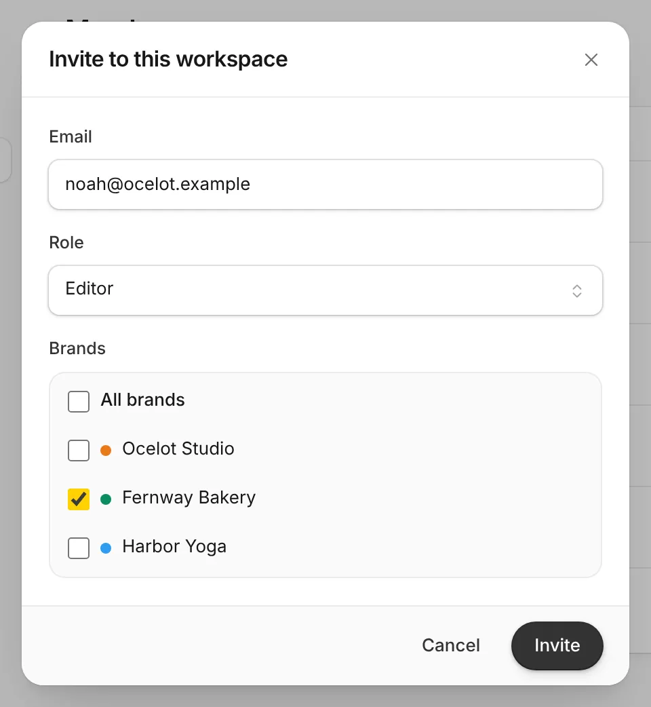
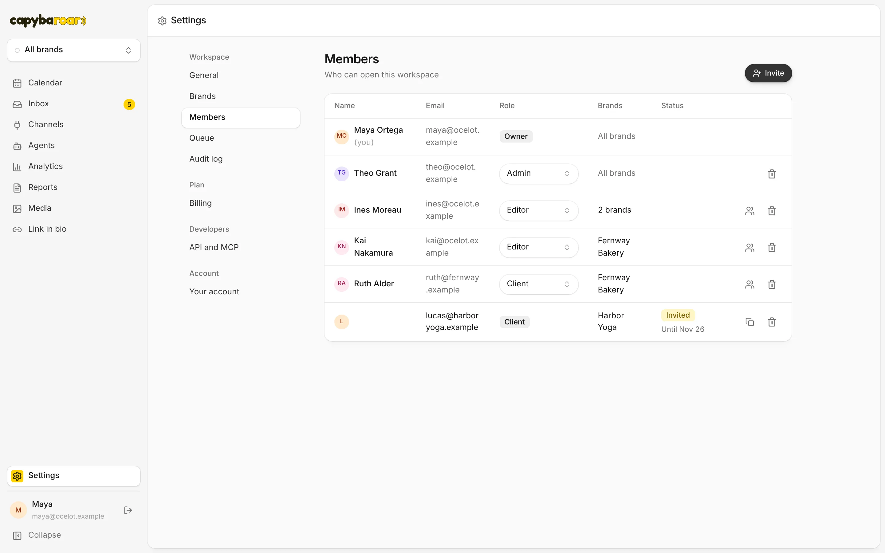

import { Aside, Badge, CardGrid, LinkCard, LinkButton, Steps } from '@astrojs/starlight/components';

A workspace holds your channels and posts, and the people who work on them. Each person has a role, and each brand keeps its own channels and posts apart. Owners and admins set this up in **Settings**.

<LinkButton href="https://app.capybaroar.com/settings?tab=members" variant="secondary" icon="external">Open in Capybaroar</LinkButton>

## Roles

| Role | What they can do | Takes a seat |
| - | - | - |
| **Owner** | Everything, including **Delete workspace** and **Export workspace**. The person who made the workspace. | Yes |
| **Admin** | Everything in the workspace: settings, billing, members, brands, API keys and webhooks. Sees every brand. | Yes |
| **Editor** | Writes, schedules and answers for the brands they're given. Their posts to a brand that needs approval wait in review. In **Settings** they see only **Your account**. | Yes |
| **Client** | Opens the calendar for their brands and approves or rejects posts. | No |

Seats count owners, admins, editors and invites still open for those roles. Free and Creator have 1 seat, Pro 5 and Agency 15.

[Roles and permissions](/reference/roles-and-permissions/) has the full grid of what each role can do, screen by screen.

## Invite someone

<Steps>

1. **Open Members.** Click **Settings**, then **Members**, and press **Invite**.

1. **Enter their email and pick a role.** Choose **Admin**, **Editor** or **Client**.

   

1. **Pick their brands.** Editors and clients see only the brands you tick. Admins see all of them.

1. **Send it.** They get an email with a link to join. You can also copy the invite link and send it yourself.

</Steps>

Open invites show as **Invited**. Press **Withdraw** to cancel one. To change someone's role later, pick a new one in the **Role** column. **Remove** takes them out of the workspace.

## The Members table

**Settings**, **Members** says **Who can open this workspace**. Owners and admins manage it.

| Column | What it shows |
| - | - |
| **Name** | The person's picture and name |
| **Email** | The address they sign in with |
| **Role** | A menu to change their role. The owner's role, and your own, show as a tag and can't change here. |
| **Brands** | **All brands**, one brand's name, or how many brands they have, when the workspace has more than one brand |
| **Status** | Members who joined, and open invites marked **Invited** |
| (actions) | **Brands** to change which brands an editor or client sees, and **Remove** |

Open invites also have **Copy invite link** and **Withdraw invite**. The box asks **Withdraw the invite for `<email>`?**.

- **Change a role:** pick a new one in **Role**. Turning a client into an admin or editor needs a free seat.
- **Change brands:** press **Brands**, tick them in **Brands for `<name>`**, and press **Save**. Owners and admins always see every brand.
- **Remove:** press **Remove**. The box asks **Remove `<name>`?** and says **`<email>` loses access to this workspace.**

## Invites

- An invite is good for 7 days. After that, the link says `This invite has expired. Ask for a new one.`
- The person must sign in with the invited address. Signing in with another one shows `This invite is for <email>. Sign in with that address.`
- When email can't be sent, **Invite link for `<email>`** shows the link to copy and send yourself.
- A workspace can send 20 invites a day, and one address can get 4 a day.

The person opens the link, sees **You're invited** and **Join `<workspace>`**, and signs in or makes an account. They land in the workspace with the role and brands you picked.

## Brands, workspace settings and your account

- [Brands](/workspace/brands/): add brands, approvals, review links, the brand kit and credit limits.
- [General settings](/workspace/settings-general/): the workspace's name, time zone, the two-factor rule, export and delete.
- [The posting queue](/publishing/posting-queue/): the times **Add to queue** fills.
- [Audit log](/workspace/audit-log/): who changed what.
- [Your account and security](/workspace/your-account/): two-factor sign-in, devices, emails, your data.

Switch between brands, or between workspaces if you belong to more than one, from the menu at the top of the sidebar.

## Related

<CardGrid>
  <LinkCard title="Approvals" href="/workspace/approvals/" />
  <LinkCard title="Plans and billing" href="/workspace/plans-and-billing/" />
</CardGrid>
