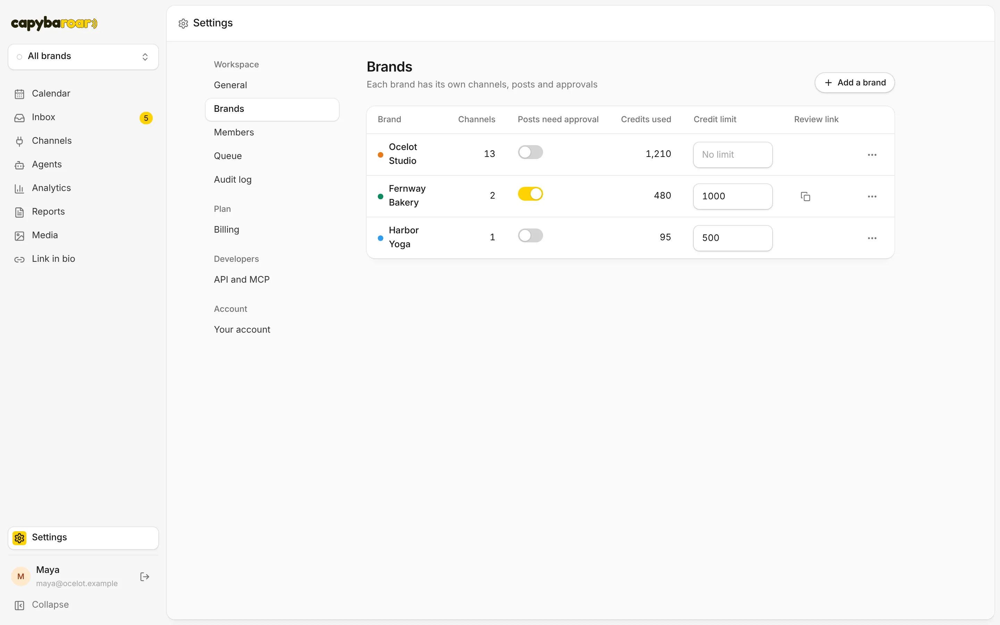
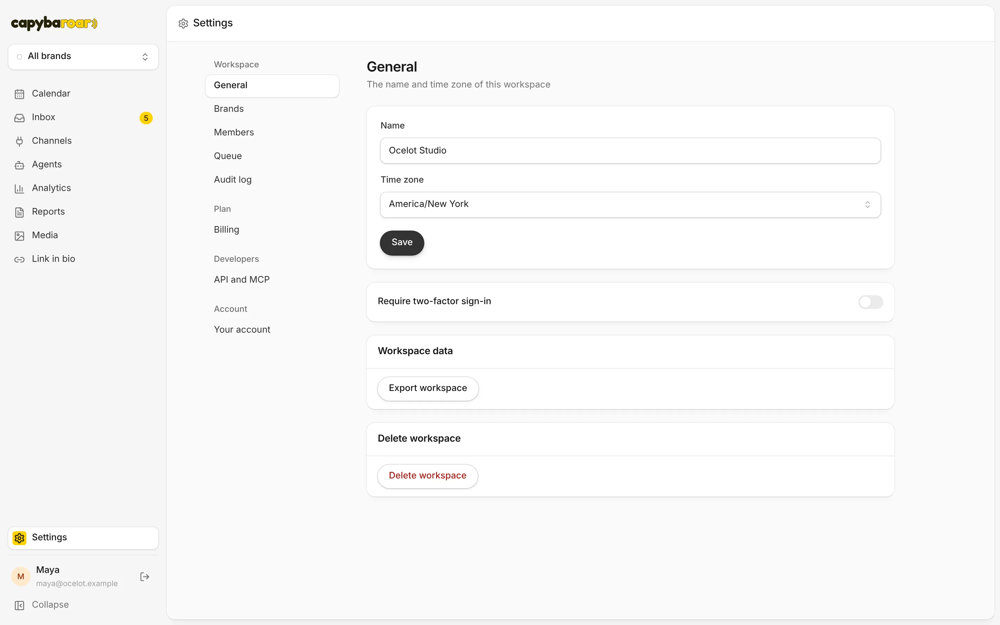
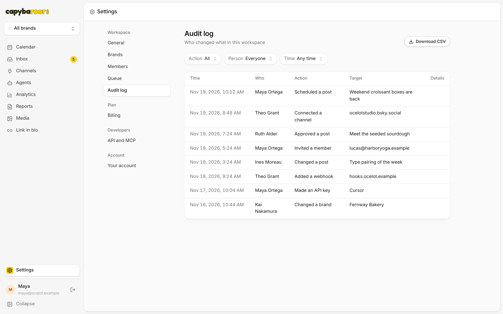
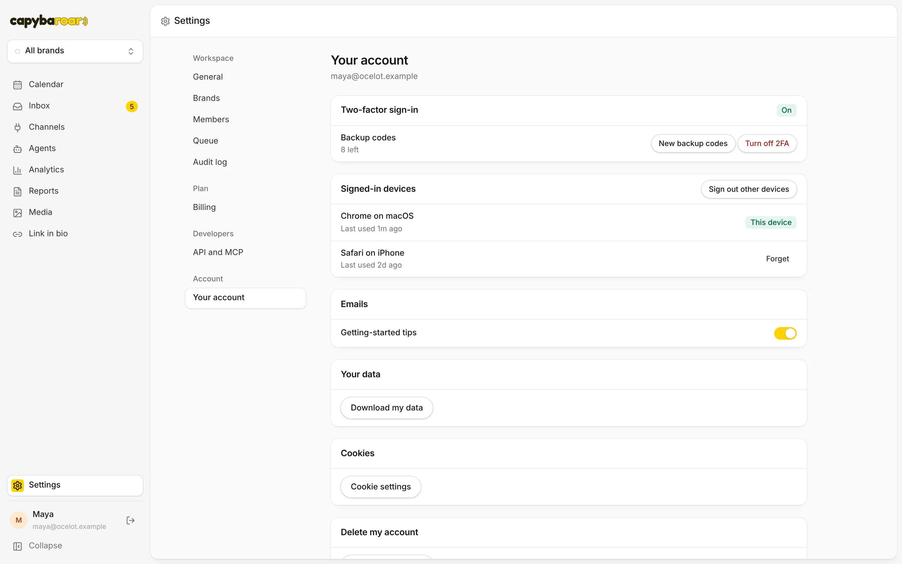

import { Aside, Badge, CardGrid, LinkCard, LinkButton, Steps } from '@astrojs/starlight/components';

A workspace holds your channels and posts, and the people who work on them. Each person has a role, and each brand keeps its own channels and posts apart. Owners and admins set this up in **Settings**.

<LinkButton href="https://app.capybaroar.com/settings?tab=members" variant="secondary" icon="external">Open in Capybaroar</LinkButton>

## Roles

| Role | What they can do | Takes a seat |
| - | - | - |
| **Owner** | Everything, including **Delete workspace** and **Export workspace**. The person who made the workspace. | Yes |
| **Admin** | Everything in the workspace: settings, billing, members, brands, API keys and webhooks. Sees every brand. | Yes |
| **Editor** | Writes, schedules and answers for the brands they're given. Their posts to a brand that needs approval wait in review. In **Settings** they see only **Your account**. | Yes |
| **Client** | Opens the calendar for their brands and approves or rejects posts. | No |

Seats count owners, admins, editors and invites still open for those roles. Free and Creator have 1 seat, Pro 5 and Agency 15.

## Invite someone

<Steps>

1. **Open Members.** Click **Settings**, then **Members**, and press **Invite**.

1. **Enter their email and pick a role.** Choose **Admin**, **Editor** or **Client**.

   

1. **Pick their brands.** Editors and clients see only the brands you tick. Admins see all of them.

1. **Send it.** They get an email with a link to join. You can also copy the invite link and send it yourself.

</Steps>

Open invites show as **Invited**. Press **Withdraw** to cancel one. To change someone's role later, pick a new one in the **Role** column. **Remove** takes them out of the workspace.

## Brands

A brand is one client, product or company. Each brand has its own channels, calendar, Inbox, results, review link and link in bio page. Free and Creator have 1 brand, Pro 5 and Agency as many as you need.

<Steps>

1. **Open Brands.** Click **Settings**, then **Brands**.

1. **Add one.** Press **New brand** and type its name.

   

1. **Move channels into it.** On **Channels**, pick the brand in each channel's **Brand** column.

</Steps>

Switch between brands with the menu at the top of the sidebar, or pick **All brands** to see everything. Each brand's menu (**More**) has **Make a review link**, **Brand kit**, **Rename** and **Delete**. A workspace always keeps at least one brand.

### Brand kit

The brand kit tells AI how to write for a brand. The agent and the AI writing tools follow it.

| Field | What to put in it |
| - | - |
| **Voice** | How the brand sounds, like "Warm and plain. Short sentences. We say we, never I." |
| **Words to avoid** | Words AI shouldn't use. The post editor also warns you when your text has one. |
| **Hashtags to add** | Hashtags the brand uses |
| **Look from website** | Type the brand's website and press **Read website**. Capybaroar reads its colors, fonts and logo for graphics made with CapyInfographic. |

### Credit limits <Badge text="Agency" />

On Agency, the Brands table shows **Credits used** and a **Credit limit** for each brand. Type a number of credits a month, or leave it empty for no limit.

## Workspace settings

- **General:** the workspace's **Name** and **Time zone**. Queue times, best times and report emails use this time zone. Here you can also require two-factor sign-in for everyone.
- **Queue:** the times **Add to queue** fills. See [Calendar, queue and campaigns](/publishing/calendar-and-queue/#the-posting-queue).
- **Audit log:** who changed what in this workspace, with filters for **Action**, **Person** and **Time**.

## Your account

Everyone has **Settings**, **Your account**:

- **Two-factor sign-in** with an authenticator app, with backup codes.
- **Signed-in devices**, with **Sign out** for every other device.
- **Download my data** for a copy of everything about you.
- **Getting-started tips**, to turn the tip emails on or off.
- **Delete my account**.

<Aside type="note">
You can belong to more than one workspace. Switch between them from the menu at the top of the sidebar.
</Aside>

## Related

<CardGrid>
  <LinkCard title="Approvals" href="/workspace/approvals/" />
  <LinkCard title="Plans and billing" href="/workspace/plans-and-billing/" />
</CardGrid>
