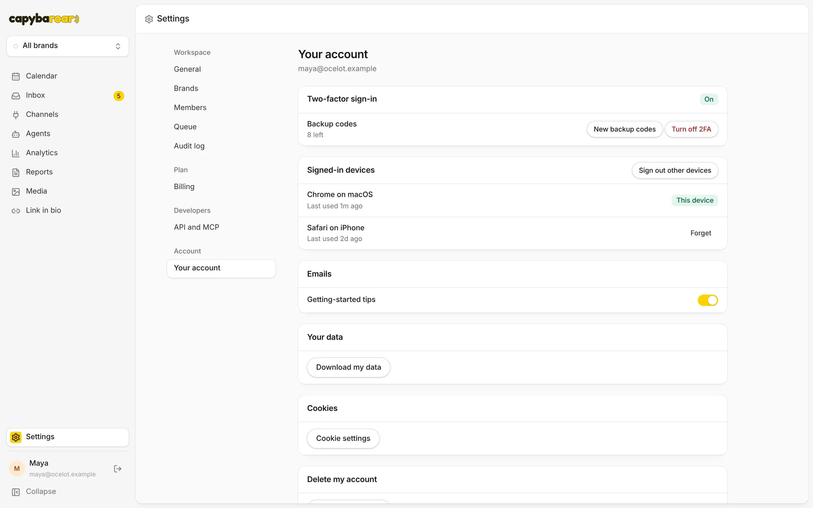

import { Aside, CardGrid, LinkCard, LinkButton, Steps } from '@astrojs/starlight/components';

**Your account** is the one Settings tab everyone has, whatever their role. It's about you, not the workspace: how you sign in, where you're signed in, your emails and your data.

<LinkButton href="https://app.capybaroar.com/settings?tab=account" variant="secondary" icon="external">Open in Capybaroar</LinkButton>

The line under the title shows the email you sign in with.

## Two-factor sign-in

Two-factor sign-in (2FA) asks for a 6-digit code from an app on your phone after your password, so a stolen password isn't enough to get in. It works with any authenticator app.

### Turn it on

<Steps>

1. **Press Turn on 2FA** under **Two-factor sign-in**.

1. **Scan the QR code** with your authenticator app. Can't scan? Press **Copy secret** and type the **Secret** into the app.

1. **Type the 6-digit Code** the app shows, then press **Verify**.

1. **Save your backup codes.** You get 10, each 10 characters. Press **Copy codes** or **Download**, keep them somewhere safe, then press **Done**.

</Steps>

From then on, signing in asks **Enter the code from your app.** after your password. Lost your phone? Press **Use a backup code** and type one. Each backup code works once.

### Backup codes and turning it off

- **Backup codes** shows how many are left, like **8 left**. **New backup codes** makes 10 new ones and stops the old ones. It asks for a **Code from your authenticator app** first.
- **Turn off 2FA** also asks for a code. While your workspace requires 2FA, it answers `<workspace> requires 2FA`.

Five wrong codes in 10 minutes lock code entry for a while: `Too many wrong codes. Try again in 15 minutes.`

## Signed-in devices

**Signed-in devices** lists each browser you're signed in on, like **Chrome on macOS**, with **Last used** and how long ago. The one you're on now shows **This device**.

- **Forget** signs out one device.
- **Sign out other devices** asks **Sign out other devices?**, says **Every device but this one is signed out.**, and signs out the rest when you press **Sign out**.

When you sign in on a new device, Capybaroar emails you. If it wasn't you, the email's **This wasn't me** link signs out every device. It works for a limited time: after that, sign in and use **Sign out other devices**, or reset your password. Resetting your password also signs out your other sessions.

## Emails

The **Emails** card has a **Getting-started tips** switch. New workspaces get a few short tips by email in their first days. Switch it off to stop them. If the switch can't save, it flips back and says `That didn't save. Try again.`

Emails about your posts, like a post that didn't go out or a channel to reconnect, go to owners and admins and aren't turned off here.

## Download my data

**Your data** has **Download my data**. It makes a ZIP of what Capybaroar holds about you: the posts and comments you wrote, your agent chats, your API keys and connected apps (with no secrets), your audit events and the terms you accepted.

1. Press **Download my data**. It shows **Preparing**.
1. You get an email with a link when it's ready, and **Download** shows here.
1. The link works for 24 hours.

You can make one a day. **Cookie settings** in the same card lets you change your cookie choices.

## Delete my account

<Steps>

1. **Press Delete my account.** The box asks **Delete your account?** and says **You leave every workspace, and workspaces where you're the only member are deleted. This can't be undone.** Press **Continue**.

1. **Type your email** to confirm, then press **Delete my account**.

</Steps>

If you're the only owner of a workspace that other people use, it stops with `Make someone else an owner of <workspace> or delete it first`. Delete that workspace in **Settings**, **General** first.

<Aside type="caution">
Deleting your account can't be undone. Use **Download my data** first if you want a copy.
</Aside>

## Signing in

You can sign in with your email and password, an email link and code, or Google when it's on. See [Sign in and sign up](/get-started/sign-in/).

## Related

<CardGrid>
  <LinkCard title="General workspace settings" href="/workspace/settings-general/" />
  <LinkCard title="Errors with your account" href="/errors/account-and-team/" />
</CardGrid>
